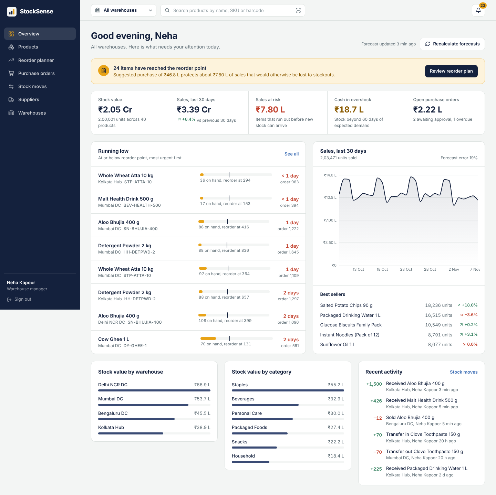
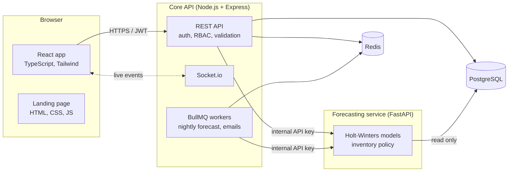
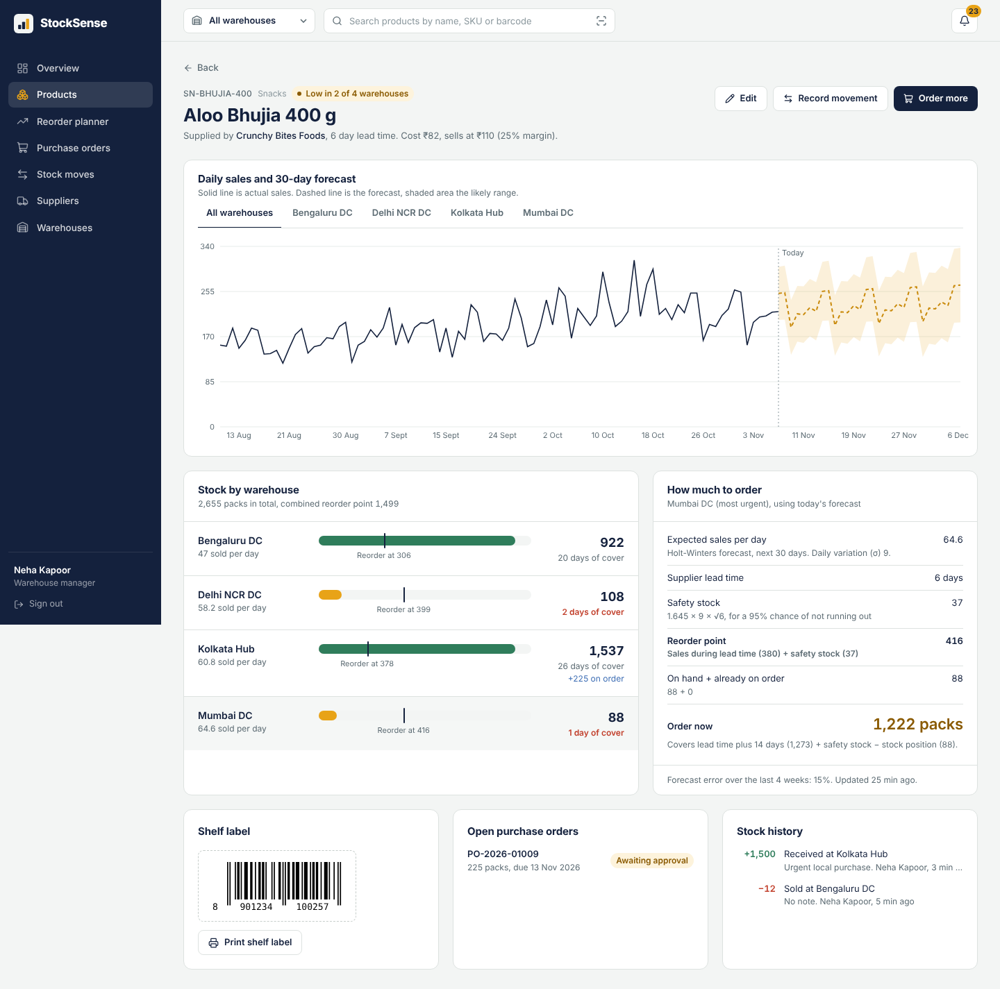
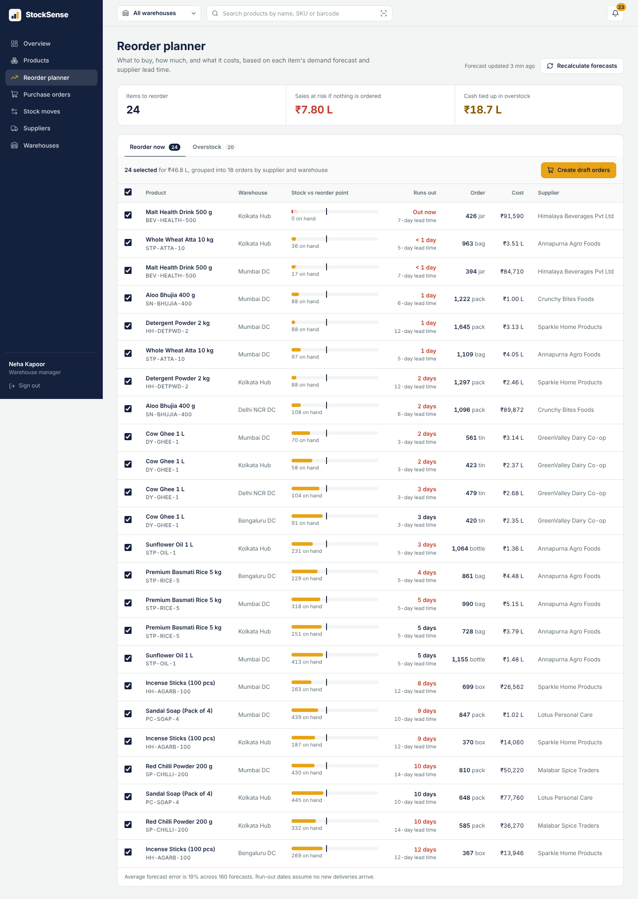
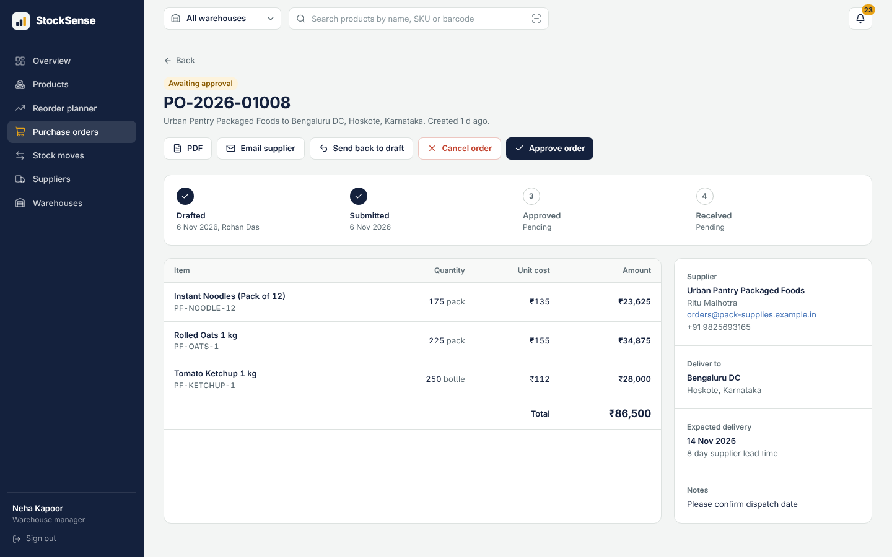
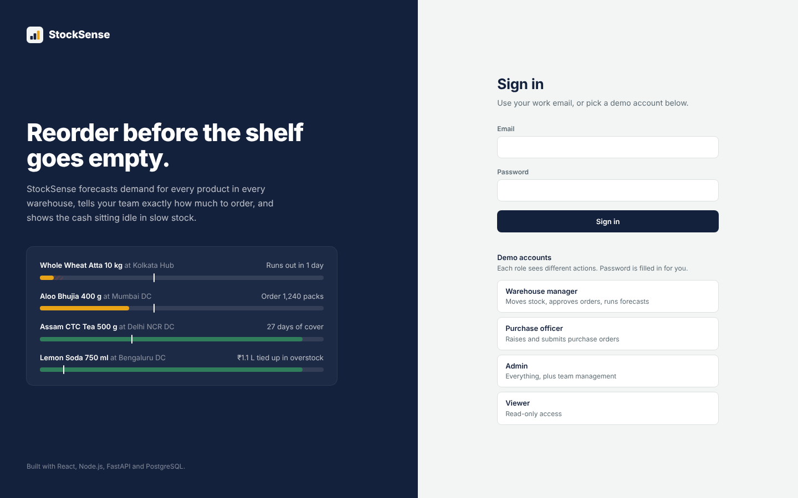
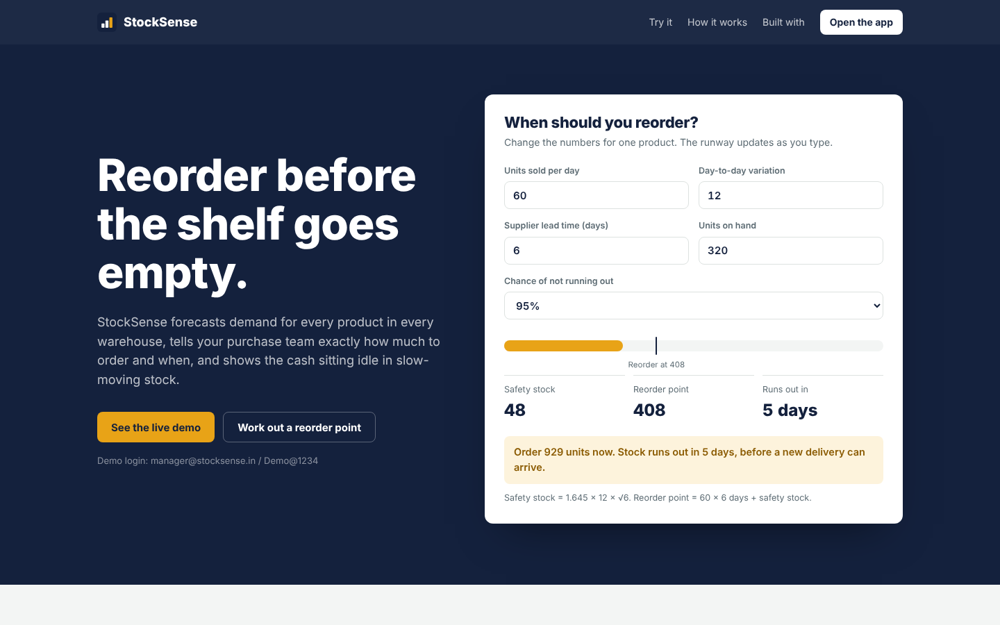

# StockSense

**Multi-warehouse inventory management with demand forecasting, built for distributors and retail chains.**

StockSense answers the question every purchase team asks each morning: *what do we need to order today, and how much?* It forecasts demand for every product in every warehouse, turns that forecast into reorder points and order quantities, drafts purchase orders grouped by supplier, and shows the cash tied up in slow-moving stock.



---

## The business problem

A mid-sized FMCG distributor with four warehouses typically loses money in two opposite ways at the same time:

- **Stockouts on fast sellers.** Orders are placed by gut feel or on a fixed schedule. A festive-season spike or a slow supplier empties the shelf and the sale goes to a competitor.
- **Cash locked in overstock.** The same warehouse holds months of an item that barely sells.

With the demo data, StockSense surfaces **₹8 lakh of sales at risk** from upcoming stockouts and **₹18 lakh of cash in overstock**, and proposes a ₹47 lakh purchase plan to fix the first while suggesting transfers between warehouses for the second.

## Features

| Area | What it does |
|---|---|
| **Dashboard** | Stock value, 30-day sales trend, sales at risk, overstock cash, open purchase orders, most urgent items, live activity feed |
| **Products** | Search by name, SKU or barcode; filter by stock status and category; sortable, paginated, URL-driven filters; per-warehouse "stock runway" bars |
| **Product detail** | 90 days of sales plus a 30-day forecast with confidence band; stock per warehouse; an **explainable reorder calculation** showing the actual formula with that product's numbers; printable barcode shelf label |
| **Reorder planner** | Every item at or below its reorder point, with run-out date, recommended quantity and cost. One click turns the selection into draft purchase orders, one per supplier and warehouse |
| **Overstock rebalancing** | Finds stock beyond 60 days of demand and suggests transferring it to a warehouse that needs the same product |
| **Purchase orders** | Draft → submit → approve → receive, enforced as a state machine with role checks. PDF generation and emailing to the supplier. Receiving adds stock in one transaction |
| **Stock movements** | Receipts, dispatches, adjustments and inter-warehouse transfers, recorded in an append-only ledger |
| **Barcode scanning** | Camera scanning (EAN-13, Code 128, QR) in the browser, with typed entry as a fallback for USB scanners |
| **Real-time** | Low-stock alerts, stock changes and finished forecasts are pushed to every open screen over WebSockets |
| **Roles** | Admin, Warehouse manager, Purchase officer, Viewer — enforced on the API and reflected in the UI |
| **Landing page** | Plain HTML/CSS/JavaScript page with a live reorder-point calculator |

## Architecture



**Why two backends?** Each does the job it is best at. Node.js owns everything transactional and real-time (auth, stock movements, purchase orders, WebSockets). Python owns the numerical work (pandas, statsmodels, SciPy), which has no good equivalent in JavaScript. The Python service is **read-only**: it reads sales history and returns forecasts, and the Node API writes them back inside a transaction. Data has one owner.

## Tech stack

| Layer | Technology |
|---|---|
| Frontend | React 19, TypeScript, Vite, Tailwind CSS 4, React Router, TanStack Query, React Hook Form, Zod, Recharts, ZXing (barcode scanning), JsBarcode, Socket.io client |
| Landing page | HTML5, CSS3, vanilla JavaScript |
| Core API | Node.js 22, Express 5, TypeScript, Drizzle ORM, Zod, JWT + bcrypt, Socket.io, BullMQ, PDFKit, Nodemailer, Helmet, express-rate-limit |
| Forecasting | Python 3.13, FastAPI, Pydantic, pandas, NumPy, statsmodels, SciPy, SQLAlchemy |
| Data | PostgreSQL 16, Redis 7 |
| Quality | Jest + Supertest, Pytest, Vitest + Testing Library, ESLint, Prettier, Ruff, GitHub Actions |
| Delivery | Docker, Docker Compose, Vercel (frontend), Render (API, forecasting, Postgres, Redis) |

## Run it

### Option A — Docker (recommended)

```bash
docker compose up --build -d
docker compose run --rm seed        # loads the demo dataset and runs the first forecast
```

| What | Where |
|---|---|
| App | http://localhost:3000 |
| Landing page | http://localhost:8081 |
| API health | http://localhost:4000/api/health |
| Forecasting API docs (Swagger) | http://localhost:8000/docs |

### Option B — run each service yourself

Needs Node.js 22+, Python 3.11+, PostgreSQL 14+ and Redis (Redis is optional; without it caching and queues switch off and work runs inline).

```bash
# 1. Database
createdb stocksense

# 2. Forecasting service
cd forecast-service
python -m venv .venv && source .venv/bin/activate
pip install -r requirements-dev.txt
cp .env.example .env
uvicorn app.main:app --port 8000 --reload

# 3. Core API (new terminal)
cd backend
npm install
cp .env.example .env            # set DATABASE_URL and secrets
npm run db:migrate
npm run db:seed                 # demo data + first forecast run
npm run dev

# 4. Frontend (new terminal)
cd frontend
npm install
npm run dev                     # http://localhost:5173
```

### Demo accounts

Password for all: `Demo@1234`

| Role | Email | Can |
|---|---|---|
| Warehouse manager | manager@stocksense.in | Move stock, approve and receive orders, run forecasts |
| Purchase officer | purchaser@stocksense.in | Create and submit purchase orders, manage suppliers |
| Admin | admin@stocksense.in | Everything, plus team management |
| Viewer | viewer@stocksense.in | Read-only |

The seed creates 4 warehouses, 8 suppliers, 40 products, 11 purchase orders across every status, and **58,000+ daily sales records** with weekly patterns, summer and festive-season peaks, growth and decline trends, and promotion spikes.

## How the forecasting works

For each product in each warehouse:

1. **Daily sales series** from the stock ledger (missing days count as zero sales).
2. **Holt-Winters exponential smoothing** with a damped additive trend and weekly seasonality, fitted on the last 120 days. Short or sparse histories fall back to a weekday-adjusted moving average.
3. **Backtest** on the last 28 days to measure accuracy (weighted absolute percentage error, about 19% on the demo data).
4. **Inventory policy:**

```
safety stock   = z × σ × √(lead time)            z = 1.645 for a 95% service level
reorder point  = expected demand during lead time + safety stock
order quantity = demand over (lead time + 14 days) + safety stock − (on hand + on order)
excess stock   = on hand − (safety stock + 60 days of demand)
```

160 models are fitted in parallel worker processes in about 10 seconds. The full run happens nightly at 02:00 IST through a BullMQ scheduled job, and on demand from the dashboard. After any stock movement or purchase-order change, only the affected products are re-forecast (milliseconds), so the planner is always current.

The product page shows this calculation with the product's real numbers, so a purchase manager can see *why* the system recommends a quantity rather than trusting a black box.



## Engineering decisions worth discussing

- **No overselling under concurrency.** Stock changes lock the `stock_levels` row with `SELECT … FOR UPDATE`, and a `CHECK (quantity >= 0)` constraint backs this up in the database. A test fires 10 parallel sales of 10 units against 50 in stock and asserts exactly 5 succeed.
- **Append-only stock ledger.** Every change is a signed row in `stock_movements`. Current stock always reconciles with the ledger (the seed verifies this), which gives a full audit trail and the forecast's demand history for free.
- **Purchase orders as a state machine.** Allowed transitions are declared in one table; anything else returns `409 Conflict`. Receiving locks the order row, so an order cannot be received twice.
- **Deadlock-safe transfers.** Both legs of a transfer run in one transaction, with rows locked in a consistent order.
- **Secure sessions.** Short-lived access tokens are kept in memory only. Refresh tokens are random, stored as SHA-256 hashes, sent as `httpOnly` cookies, and **rotated on every use** (a replayed token is rejected — covered by a test). Login is rate-limited and returns the same error for unknown emails and wrong passwords.
- **Validation everywhere.** Zod validates environment variables at startup, every request on the API, and every form in the browser. Pydantic does the same in Python.
- **Graceful degradation.** If Redis is down, caching and queues switch off and work runs inline. If the forecasting service is down, the app keeps working and the next run catches up.
- **Caching with invalidation.** The aggregation-heavy dashboard is cached in Redis for 60 seconds and invalidated on every stock or purchase-order change.
- **Performance on the frontend.** Every page is lazy-loaded; charts and the barcode scanner are separate chunks, so the first screen downloads only what it needs.
- **Money is never a float.** Prices are `NUMERIC` in PostgreSQL; rupees display in lakhs and crores.

## Tests

```bash
cd backend && npm test              # 23 integration tests: auth, RBAC, concurrency, transfers, PO lifecycle, PDF
cd forecast-service && pytest       # 15 tests: forecasting maths, inventory policy, API auth
cd frontend && npm test             # formatting (₹ lakhs/crores, cover days)
```

GitHub Actions runs lint, type checks, tests and builds for all three services on every push (`.github/workflows/ci.yml`). The backend job runs against a real PostgreSQL service container.

## Deploy

**API, forecasting, Postgres and Redis on Render:** push the repo to GitHub, then in Render choose *New → Blueprint* and select the repository. `render.yaml` creates everything. Set `CLIENT_ORIGIN` to your Vercel URL. To load the demo data, copy the database's *External URL* from Render and run `DATABASE_URL=<that url> npm run db:seed` from the `backend` folder on your machine (the API applies migrations itself on every deploy).

**Frontend on Vercel:** import the repo, set the root directory to `frontend`, and add `VITE_API_URL=https://<your-api>.onrender.com`. `vercel.json` handles client-side routing.

Because the frontend and API are then on different domains, the API is configured with `COOKIE_SAMESITE=none` and `COOKIE_SECURE=true` so the refresh cookie still works.

**Landing page:** any static host (Vercel, Netlify, GitHub Pages). Set `window.STOCKSENSE_APP_URL` or edit `APP_URL` in `landing/script.js` to point at the app.

## Project structure

```
stocksense/
├── backend/                  Node.js + Express API
│   ├── src/
│   │   ├── db/               Drizzle schema, client, migration runner
│   │   ├── modules/          auth, products, stock, purchase-orders, forecasts, dashboard, …
│   │   ├── middleware/       auth + RBAC, validation, error handling
│   │   ├── jobs/             BullMQ queues and workers
│   │   └── lib/              Redis cache, Socket.io, mailer, forecast client
│   ├── drizzle/              SQL migrations
│   ├── scripts/seed.ts       demo dataset generator
│   └── tests/                Jest + Supertest
├── forecast-service/         FastAPI forecasting service
│   ├── app/forecasting.py    models and inventory maths (pure functions)
│   ├── app/main.py           API + parallel execution
│   └── tests/
├── frontend/                 React app
│   └── src/{pages,components,api,hooks,lib}
├── landing/                  HTML/CSS/JS marketing page
├── docker-compose.yml
├── render.yaml
└── .github/workflows/ci.yml
```

## API overview

All routes are under `/api` and need `Authorization: Bearer <token>` except login and refresh.

| Method | Route | Purpose |
|---|---|---|
| POST | `/auth/login`, `/auth/refresh`, `/auth/logout` | Session management |
| GET | `/dashboard/summary?warehouseId=` | Everything the dashboard needs, cached |
| GET | `/products?q=&status=&category=&sort=&page=` | Search and filter products |
| GET | `/products/lookup?code=` | Barcode or SKU lookup for the scanner |
| GET | `/products/:id`, `/products/:id/history` | Detail, sales history and forecast |
| POST | `/stock/movements`, `/stock/transfers` | Record stock changes |
| GET | `/forecasts/recommendations?view=reorder\|excess` | Reorder planner data |
| POST | `/forecasts/run` | Queue a forecast run |
| GET/POST | `/purchase-orders`, `/purchase-orders/from-recommendations` | List, create, draft from forecast |
| POST | `/purchase-orders/:id/{submit,approve,reject,receive,cancel}` | Lifecycle transitions |
| GET/POST | `/purchase-orders/:id/pdf`, `/purchase-orders/:id/email` | PDF and email to supplier |
| GET/POST/PATCH | `/suppliers`, `/warehouses`, `/users` | Master data and team |

The forecasting service documents itself at `/docs` (Swagger UI).

## Resume bullets

- Built **StockSense**, a full-stack inventory and demand-forecasting platform (React, TypeScript, Node.js, FastAPI, PostgreSQL, Redis, Docker) serving multi-warehouse stock tracking, purchase-order workflows and real-time alerts.
- Designed a **Python forecasting microservice** that fits 160 Holt-Winters models in parallel in ~10 s and converts forecasts into safety stock, reorder points and order quantities; surfaced ₹8 L of at-risk sales and ₹18 L of overstock on a 58,000-record dataset.
- Prevented overselling under concurrent requests using **PostgreSQL row-level locking** and check constraints, verified by integration tests; implemented a purchase-order **state machine** with role-based approvals, PDF generation and supplier email.
- Implemented **JWT auth with rotating httpOnly refresh tokens**, role-based access control, Redis caching, BullMQ scheduled jobs and Socket.io live updates; covered by 40+ automated tests in a GitHub Actions CI pipeline.

## More screenshots

| | |
|---|---|
|  |  |
|  |  |

---

All company, product and supplier names in the demo data are fictional.
